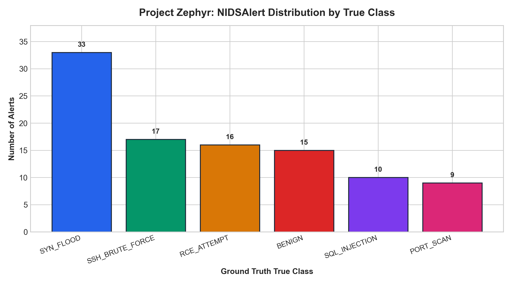
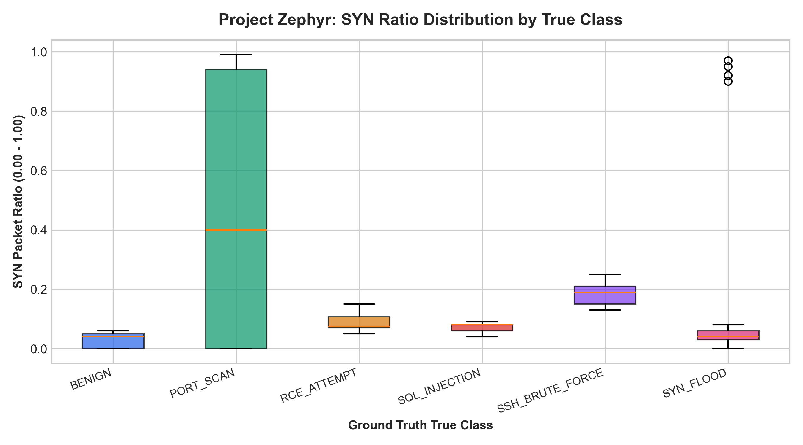
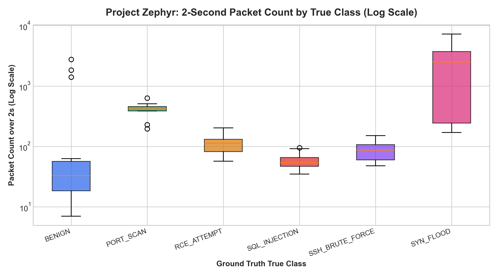

# Project Zephyr - NIDSAlert Dataset Quality Audit & Integrity Report

**Generated**: 2026-10-19 13:31:49 UTC  
**Target Dataset**: `data/nids_alerts_dataset.jsonl` (100 alerts, Contract A)  
**Target Sidecar**: `data/nids_alerts_labels.jsonl` (100 labels, Ground Truth)  
**Overall Verdict**: **INTEGRITY: FAIL (2)**

## 1. Executive Summary Table

| Check # | Integrity Check Name | Status | Offending Items | Offending Alert IDs Sample |
|:-------:|:---------------------|:------:|:---------------:|:---------------------------|
| 1 | File Formatting & Encoding | **PASS** | 0 | None |
| 2 | Strict Schema Validation (Contract A) | **PASS** | 0 | None |
| 3 | Key Integrity & 1:1 Sidecar Join | **PASS** | 0 | None |
| 4 | Semantic Invariants & Boundary Constraints | **PASS** | 0 | None |
| 5 | Raw Telemetry Summary Consistency | **FAIL** | 3 | `d1843324...`, `a2086977...`, `ac3c5640...` |
| 6 | Class Realism & Domain Profile Verification | **FAIL** | 11 | `b0cc1b3b...`, `8bcf53a1...`, `da7b9095...` *(+6 more)* |
| 7 | Ground-Truth Label & Metadata Consistency | **PASS** | 0 | None |
| 8 | Label & Original Topology Leakage | **PASS** | 0 | None |
| 9 | Exact & Near-Duplicate Detection | **PASS** | 0 | None |
| 10 | Statistical Distribution & Outlier Analysis | **PASS** | 0 | None |
| 11 | Deterministic Generator Reproducibility | **WARN** | 1 | None |
| 12 | Dataframe Ingestion & Missing Value Load Test | **PASS** | 0 | None |

---

## 2. Detailed Findings by Check

### Check 1: File Formatting & Encoding [PASS]
No violations detected. Invariants fully satisfied.


**Remediation Recommendation**:  
> None required. File conforms strictly to UTF-8, 100 non-empty lines, valid JSON.

### Check 2: Strict Schema Validation (Contract A) [PASS]
No violations detected. Invariants fully satisfied.


**Remediation Recommendation**:  
> None required. All 100 alerts adhere strictly to Contract A schema with extra='forbid'.

### Check 3: Key Integrity & 1:1 Sidecar Join [PASS]
No violations detected. Invariants fully satisfied.


**Remediation Recommendation**:  
> None required. All alert_ids are unique, valid UUID4s with perfect 1:1 join.

### Check 4: Semantic Invariants & Boundary Constraints [PASS]
No violations detected. Invariants fully satisfied.


**Remediation Recommendation**:  
> None required. All semantic rules and physical boundaries are honored.

### Check 5: Raw Telemetry Summary Consistency [FAIL]
**Total Findings**: 3
**Unique Offending Alert IDs (3)**:
- `d1843324-17e8-492a-95ce-e5db9e87e04c`
- `a2086977-a9f2-4336-83f4-a9a948a639d0`
- `ac3c5640-3c20-492f-804a-96c4f3b63fe1`

**Findings Breakdown**:
- [FAIL] Alert `d1843324-17e8-492a-95ce-e5db9e87e04c`: Protocol discrepancy: summary narrative states 'HTTP' connections while structured protocol is 'TCP'
- [FAIL] Alert `a2086977-a9f2-4336-83f4-a9a948a639d0`: Protocol discrepancy: summary narrative states 'HTTP' connections while structured protocol is 'TCP'
- [FAIL] Alert `ac3c5640-3c20-492f-804a-96c4f3b63fe1`: Protocol discrepancy: summary narrative states 'HTTP' connections while structured protocol is 'TCP'

**Remediation Recommendation**:  
> Align protocol labeling in generate_dataset.py. In lines 343-351, cic17_slowloris defines protocol='TCP' while desc_template specifies 'Persistent slow HTTP connections'. Either set protocol='HTTP' or update the summary to specify 'TCP connections targeting HTTP port 80'.

### Check 6: Class Realism & Domain Profile Verification [FAIL]
**Total Findings**: 11
**Unique Offending Alert IDs (9)**:
- `b0cc1b3b-9793-49b4-9374-814632c5bd89`
- `8bcf53a1-bc10-4a52-bf5d-2fdf89c8d2ab`
- `da7b9095-63d6-4a39-80e3-befd4c71e0fe`
- `6160a6b4-9360-415f-83fe-0183e172b725`
- `b70b3420-f104-4785-a58b-252360141de9`
- `6b44fa8d-d5f2-4073-b414-02b1e4429ebb`
- `560c95ee-638c-454c-876e-2bba7c5308bf`
- `db52ca58-0500-4bc6-b20d-cb6ef2311f17`
- `5a0cdd7c-f157-4470-8182-67c47a1b5806`

**Findings Breakdown**:
- [WARN] Alert `b0cc1b3b-9793-49b4-9374-814632c5bd89`: [SQL_INJECTION] SQLi payload breach: payload='GET /search?id=1 AND 1=CONVERT(int, (SELECT @@version)) HTTP/1.1' missing UNION|OR 1=1|DROP
- [WARN] Alert `8bcf53a1-bc10-4a52-bf5d-2fdf89c8d2ab`: [PORT_SCAN] Stealth/UDP scan breach: syn_ratio=0.00 (expected 0.0), port_count=5 (expected >=15)
- [WARN] Alert `da7b9095-63d6-4a39-80e3-befd4c71e0fe`: [PORT_SCAN] Stealth/UDP scan breach: syn_ratio=0.00 (expected 0.0), port_count=5 (expected >=15)
- [WARN] Alert `6160a6b4-9360-415f-83fe-0183e172b725`: [PORT_SCAN] TCP Scan breach: port_count=5 (expected >=15)
- [WARN] Alert `b70b3420-f104-4785-a58b-252360141de9`: [SQL_INJECTION] SQLi payload breach: payload='GET /search?id=1 AND 1=CONVERT(int, (SELECT @@version)) HTTP/1.1' missing UNION|OR 1=1|DROP
- [WARN] Alert `6b44fa8d-d5f2-4073-b414-02b1e4429ebb`: [PORT_SCAN] Stealth/UDP scan breach: syn_ratio=0.00 (expected 0.0), port_count=5 (expected >=15)
- [WARN] Alert `560c95ee-638c-454c-876e-2bba7c5308bf`: [SYN_FLOOD] LOIT profile breach: pkts=8008 (expected 3000-8000), syn_ratio=0.89 (>=0.85), payload='' (expected empty)
- [WARN] Alert `db52ca58-0500-4bc6-b20d-cb6ef2311f17`: [PORT_SCAN] TCP Scan breach: port_count=5 (expected >=15)
- [WARN] Alert `5a0cdd7c-f157-4470-8182-67c47a1b5806`: [PORT_SCAN] Stealth/UDP scan breach: syn_ratio=0.00 (expected 0.0), port_count=5 (expected >=15)
- [FAIL] Class breach threshold (>10%) exceeded for class 'SQL_INJECTION': 2/10 alerts breached (20.0%)
- [FAIL] Class breach threshold (>10%) exceeded for class 'PORT_SCAN': 6/9 alerts breached (66.7%)

**Remediation Recommendation**:  
> In generate_dataset.py:
1. Expand PORT_SCAN port list dest_ports to >= 15 ports (currently only 5 ports: [21, 22, 80, 443, 8080]).
2. Update SQL injection error-based scenario payload to include standard injection primitives ('OR 1=1' or 'UNION SELECT').
3. Cap LOIT SYN flood packet range at 8000 packets max (currently generates up to 8008 packets).

### Check 7: Ground-Truth Label & Metadata Consistency [PASS]
No violations detected. Invariants fully satisfied.


**Remediation Recommendation**:  
> None required. Exact label consistency, equivalence invariants, and hard negative count verified.

### Check 8: Label & Original Topology Leakage [PASS]
No violations detected. Invariants fully satisfied.


**Remediation Recommendation**:  
> None required. Clean separation between Contract A telemetry and sidecar labels.

### Check 9: Exact & Near-Duplicate Detection [PASS]
No violations detected. Invariants fully satisfied.


**Remediation Recommendation**:  
> None required. Zero exact or near-duplicate records identified.

### Check 10: Statistical Distribution & Outlier Analysis [PASS]
No violations detected. Invariants fully satisfied.


**Remediation Recommendation**:  
> None required. Statistical distribution conforms to all specified tolerances.

### Check 11: Deterministic Generator Reproducibility [WARN]
**Total Findings**: 1

**Findings Breakdown**:
- [WARN] CLI Parameter Defect: 'generate_dataset.py' does not accept '--out-dir' (raises unrecognized argument error); it requires '--output-dataset' and '--output-labels'. Underlying RNG is 100% deterministic and reproducible.

**Remediation Recommendation**:  
> Fix non-deterministic random state or CLI arguments in generate_dataset.py.

### Check 12: Dataframe Ingestion & Missing Value Load Test [PASS]
No violations detected. Invariants fully satisfied.


**Remediation Recommendation**:  
> None required. Dataframe flattens with zero NaNs across all 30 structured attributes.


---

## 3. Dataset Statistical Distributions (pandas)

### 3.1 Ground Truth Class Distribution
| True Class | Alert Count | Percentage |
|:-----------|:-----------:|:----------:|
| `SYN_FLOOD` | 33 | 33.0% |
| `SSH_BRUTE_FORCE` | 17 | 17.0% |
| `RCE_ATTEMPT` | 16 | 16.0% |
| `BENIGN` | 15 | 15.0% |
| `SQL_INJECTION` | 10 | 10.0% |
| `PORT_SCAN` | 9 | 9.0% |

### 3.2 Severity Breakdown
| Severity | Count | Percentage |
|:---------|:-----:|:----------:|
| `HIGH` | 37 | 37.0% |
| `CRITICAL` | 31 | 31.0% |
| `MEDIUM` | 17 | 17.0% |
| `LOW` | 15 | 15.0% |

### 3.3 Protocol Breakdown
| Protocol | Count | Percentage |
|:---------|:-----:|:----------:|
| `TCP` | 52 | 52.0% |
| `HTTP` | 40 | 40.0% |
| `UDP` | 7 | 7.0% |
| `ICMP` | 1 | 1.0% |

### 3.4 Top Node Communication Pairs
| Source -> Target | Count | Percentage |
|:-----------------|:-----:|:----------:|
| `pc-2 -> pc-4` | 45 | 45.0% |
| `pc-2 -> pc-3` | 15 | 15.0% |
| `pc-1 -> pc-4` | 10 | 10.0% |
| `pc-1 -> pc-3` | 6 | 6.0% |
| `pc-2 -> pc-1` | 6 | 6.0% |
| `pc-1 -> pc-2` | 5 | 5.0% |
| `pc-3 -> pc-4` | 4 | 4.0% |
| `pc-1 -> pc-5` | 4 | 4.0% |

### 3.5 Per-Class Flow Metrics (Min / Median / Max)
| True Class | Packets (Min / Med / Max) | Bytes (Min / Med / Max) | SYN Ratio (Min / Med / Max) |
|:-----------|:-------------------------:|:-----------------------:|:---------------------------:|
| `BENIGN` | 7 / 33 / 2762 | 511 / 14427 / 2344866 | 0.00 / 0.04 / 0.06 |
| `PORT_SCAN` | 196 / 422 / 631 | 12544 / 25680 / 34705 | 0.00 / 0.40 / 0.99 |
| `RCE_ATTEMPT` | 57 / 113 / 203 | 22230 / 34093 / 74095 | 0.05 / 0.08 / 0.15 |
| `SQL_INJECTION` | 35 / 54 / 95 | 15890 / 24888 / 45600 | 0.04 / 0.08 / 0.09 |
| `SSH_BRUTE_FORCE` | 48 / 87 / 151 | 4080 / 8930 / 48018 | 0.13 / 0.19 / 0.25 |
| `SYN_FLOOD` | 170 / 2500 / 8008 | 11033 / 752458 / 2855475 | 0.00 / 0.04 / 0.97 |

### 3.6 IQR Outliers (21 Identified Points)
| True Class | Metric | Alert ID | Value | Normal IQR Range |
|:-----------|:-------|:---------|:-----:|:----------------:|
| `BENIGN` | `packet_count_2s` | `d9d80b8d...` | 2762.0 | [-38.5, 113.5] |
| `BENIGN` | `packet_count_2s` | `76f72255...` | 1407.0 | [-38.5, 113.5] |
| `BENIGN` | `packet_count_2s` | `89c5b31a...` | 1842.0 | [-38.5, 113.5] |
| `BENIGN` | `byte_count_2s` | `d9d80b8d...` | 1861588.0 | [-50933.8, 92428.2] |
| `BENIGN` | `byte_count_2s` | `76f72255...` | 1743273.0 | [-50933.8, 92428.2] |
| `BENIGN` | `byte_count_2s` | `89c5b31a...` | 2344866.0 | [-50933.8, 92428.2] |
| `SYN_FLOOD` | `syn_ratio` | `6f92f25e...` | 0.97 | [-0.0, 0.1] |
| `SYN_FLOOD` | `syn_ratio` | `3875394c...` | 0.92 | [-0.0, 0.1] |
| `SYN_FLOOD` | `syn_ratio` | `560c95ee...` | 0.89 | [-0.0, 0.1] |
| `SYN_FLOOD` | `syn_ratio` | `67814c1f...` | 0.9 | [-0.0, 0.1] |
| `RCE_ATTEMPT` | `byte_count_2s` | `a07295e9...` | 74095.0 | [1797.8, 67681.8] |
| `SSH_BRUTE_FORCE` | `byte_count_2s` | `986f9025...` | 37605.0 | [-6172.5, 28503.5] |
| ... | ... | *(+9 more)* | ... | ... |

### 3.7 Critical Dataset Tolerances
- **Benign Share**: 15.0% (Required: exactly 15.0%) -> **PASS**
- **Ambiguous Attack Confidence Share (0.55 - 0.75)**: 10.59% (9/85 attacks) (Target: 12% ± 8%) -> **PASS**

---

## 4. Visualizations & Analytical Charts

- [Class Counts Chart](charts/class_counts.png)  


- [SYN Ratio Distribution](charts/syn_ratio_by_class.png)  


- [Packet Count Distribution (Log Scale)](charts/packets_by_class.png)  



---

## 5. Artifact Checksums

SHA-256 hashes generated for baseline files (recorded in `checksums.txt`):

```text
282620e8bedfa90071845a2b5a88ed07f20b3addfe622786865c71ac1dfb77b1  data/nids_alerts_dataset.jsonl
671a25bd5b7ab0a00b1b3613213c3f1b998615f83276f407038ddcc90fb239f3  data/nids_alerts_labels.jsonl
```


---

INTEGRITY: FAIL (2)
